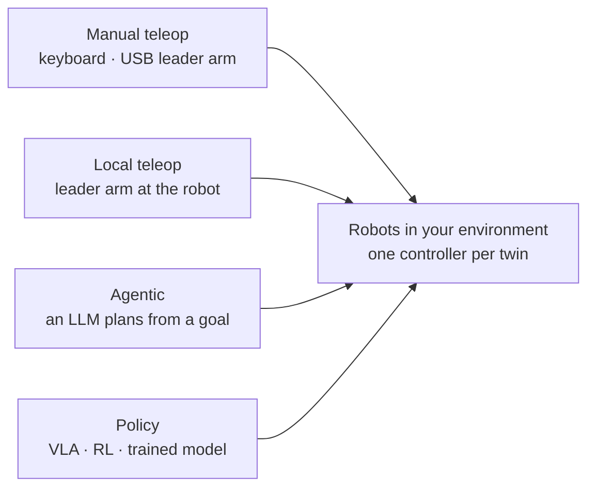

Every twin has exactly one **controller**, and every controller belongs to one of four categories. They are alternatives, not steps: pick the one that fits the task, and switch whenever you like. Each drives the same twins, in simulation or on hardware. Switching doesn't stop telemetry or recording, so a session can start manual, hand over to a model, and fall back to a person if something goes wrong.

| Controller | Who decides the next action | Use it for | Start here |
| --- | --- | --- | --- |
| **Manual teleop** | A person in the browser, with the keyboard or a USB leader arm over WebSerial | Demos, recovery | [Teleoperation](/feature-reference/environment-editor/teleoperation) |
| **Local teleop** | A person at the robot, with a leader arm or remote wired to its edge | Recording demonstrations | [SO-101 teleop dataset](/tutorials/so101-teleop-dataset) |
| **Agentic** | An LLM that plans from your goal, using only the actions the robot supports | "Move to waypoint A", "run the pick skill" | [Control agent](/ai/control-agent) |
| **Policy** | A trained model, such as a VLA from camera frames and an instruction, or an RL policy trained in simulation | Manipulation learned from demonstrations, locomotion | [Fine-tune SmolVLA](/feature-reference/ml-models/smolvla-training), [RL tasks](/feature-reference/rl-tasks) |

[Skills](/feature-reference/arm-commands) (a saved pose, a standard command, a trained skill) and [workflows](/feature-reference/workflows) are not controllers: a person, a workflow or the Agentic controller calls them.

## Assign a controller

- **In the dashboard:** select the twin and use **Choose controller** in the **Controller** section of the right-hand panel. A person can take over from the same panel at any time.
- **From Python:** `twin.policy.list()` shows the controllers available to a twin, `twin.policy.assign(policy)` hands it over, and `twin.policy.ensure_attached()` lets your script drive it.
- **From an agent:** the [control agent](/ai/control-agent) plans an action or a skill run, and you approve it before it executes.

To change a controller's settings (keys, the Agentic model and instructions, the Policy model), open them from the same section and save them for **This twin** or **All twins in this environment**. The controller itself is not copied; **Reset to defaults** removes your changes. Use **Duplicate** in the controller catalog only when you want a new reusable controller.

How controllers are routed, where each type runs, and how code controllers and RL checkpoints run on a controller host: [Controllers and handover](/feature-reference/online-controllers).

## Where the models come from

Manual sessions, skills and workflows all produce recordings. Recordings become datasets, and datasets train VLA models and RL policies. See [Data for training](/feature-reference/datasets/import).

## Next steps

<CardGroup cols={2}>
  <Card title="Your first AI loop" icon="wand-magic-sparkles" href="/overview/first-ai-loop">
    A camera, a model and an SO-101 twin that picks and sorts.
  </Card>
  <Card title="Train a VLA on the SO-101" icon="brain" href="/tutorials/train-vla-cyberwave">
    Record demonstrations, fine-tune, deploy the model as the controller.
  </Card>
  <Card title="Build a workflow" icon="diagram-project" href="/feature-reference/workflows">
    Triggers, models and robot commands on a canvas.
  </Card>
  <Card title="AI agents" icon="comments" href="/ai/agents">
    Let an assistant plan the action, then approve it.
  </Card>
</CardGroup>
