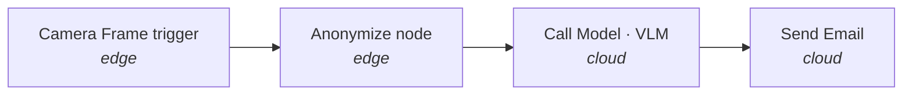
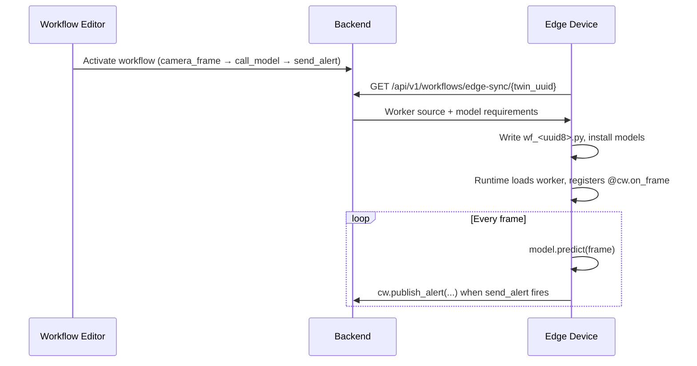
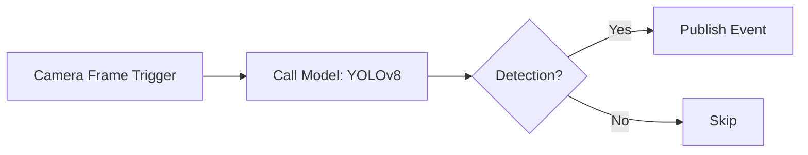

A **workflow** is a graph of nodes that runs on its own: a trigger fires, and the workflow calls models, moves twins, checks conditions, and talks to other systems. You build it visually, in Python, or with an assistant, and run it in the cloud, on the edge, or in simulation.

```python
from cyberwave import Cyberwave

cw = Cyberwave()

run = cw.workflows.trigger(
    "acme/workflows/pick-and-place",
    inputs={"target_position": [1.0, 2.0, 0.0], "speed": 0.5},
)
run.wait(timeout=60)
print(run.status)
```

---

## What are workflows?

Workflows are Cyberwave's automation primitive. They turn a graph of nodes (triggers, models, twins, conditions, integrations) into a runnable artifact. That artifact can fire on a schedule, an MQTT message, a webhook, or every camera frame on a Raspberry Pi.

You connect nodes visually to build complex behaviors without writing procedural code. The graph and the Python are two views of one object, so you can open, edit, and visualize the same workflow in the workflow editor or in code.

Workflows can run **on the cloud** (Celery tasks) or **on the edge device**, depending on the trigger type. Cloud triggers handle schedule, webhook, event, and manual execution. The `camera_frame` trigger runs ML inference directly on the edge, so no video leaves the device.

### Three ways to build one

You never have to pick between a low-code graph and "real" code. Cyberwave keeps the two in sync.

<CardGroup cols={3}>
  <Card title="Visual editor" icon="diagram-project" href="#creating-a-workflow">
    Drag nodes from the palette, wire ports, configure parameters. Great for
    prototyping and for handing flows to non-engineers.
  </Card>
  <Card title="Python SDK" icon="python" href="/overview/tools/python-sdk#workflows">
    Build, list, trigger, and monitor workflows from
    [`cw.workflows`](/overview/tools/python-sdk#workflows). Anything you can do in the UI
    you can do in code.
  </Card>
  <Card title="With an agent" icon="sparkles" href="#workflow-assistant">
    Use the [workflow assistant](#workflow-assistant) in the workbench, or describe
    the automation in plain English to Claude, Cursor, or any MCP client.
    Cyberwave's [MCP server](/overview/tools/mcp-server) and
    [Claude skill](/overview/tools/claude-skill) wire up the graph for you.
  </Card>
</CardGroup>

Every workflow round-trips between graph and Python, with no lock-in to either format. You get pure code where you need it and a visual graph everywhere else.

---

## Workflow components

### Nodes

Nodes are the building blocks of workflows. Each node performs a specific action. For every node in the palette, what it does, and where it runs, see [Workflow nodes](/overview/features/workflow-nodes).

Nodes are organised into a hybrid robotics + automation taxonomy. The same categories show up in the editor palette and on `GET /api/v1/workflows/config` (`node_categories`), so the docs, the API, and the UI all read from the same `WorkflowNodeCategory` enum (see `cyberwave-backend/src/lib/node_categories.py`). Categories with no nodes today (Perception) are reserved. They appear in the API response but are hidden in the palette until they ship.

<CardGroup cols={2}>
  <Card title="Triggers" icon="bolt">
    Start the workflow on an event, schedule, or incoming message: manual, schedule, webhook, event, MQTT, email, camera_frame, alert
  </Card>
  <Card title="Data Sources" icon="database">
    Pull snapshots and samples from sensors, cameras, and external systems on demand: `data_source`
  </Card>
  <Card title="Perception" icon="eye">
    Convert raw signals into reliable observations — reserved for object trackers, sensor fusion, IMU filtering, ASR (no nodes ship today)
  </Card>
  <Card title="Transform & Routing" icon="shuffle">
    Reshape, convert, route, multiplex, or fan out data: `json_parser`, `annotate`, `anonymize`, `send_depth` (edge-only)
  </Card>
  <Card title="State & Memory" icon="database">
    Store and retrieve memory over time: `create_asset`, `edit_asset`, `create_attachment`, `update_attachment`, `video_tagger`
  </Card>
  <Card title="Intelligence" icon="brain">
    Use models for interpretation, reasoning, or prediction: `call_model` (cloud VLM/LLM and edge ML)
  </Card>
  <Card title="Decision & Control Flow" icon="code-branch">
    Choose what happens next: `conditional`, `loop`; FSM / Behavior Tree / Rule Engine on the roadmap
  </Card>
  <Card title="Actuation" icon="robot">
    Execute physical or twin-side actions: `twin_control` (Move Twin); future joint / gripper / navigation primitives
  </Card>
  <Card title="Integration" icon="plug">
    Talk to external systems and run user-supplied logic: `http_request`, `send_email`, `send_mqtt`, `code` (edge-only)
  </Card>
  <Card title="Observability & Safety" icon="shield-halved">
    Guard, validate, observe, and alert: `send_alert`; validators, watchdogs, e-stop guards, and anomaly detectors are on the roadmap
  </Card>
</CardGroup>

### Connections

Connections define the execution flow between nodes:
- **Sequential**: Execute nodes one after another
- **Parallel**: Execute multiple nodes simultaneously
- **Conditional**: Branch based on conditions

<Info>
Connection validation prevents invalid graphs: trigger nodes cannot accept incoming connections, cycles are blocked, and `camera_frame` triggers can only connect to `call_model` nodes.
</Info>

To fire one shared downstream chain from many upstream nodes without copying it per branch, see [Reusing chains across upstreams](/feature-reference/workflows/reusing-chains).

---

## Trigger types

A trigger decides when a workflow runs and where it runs.

| Trigger | Where it runs | How it fires |
|---------|--------------|-------------|
| **Manual** | Cloud (Celery) | User clicks "Run" in the UI or triggers via SDK/API |
| **Schedule** | Cloud (Celery) | Cron or interval timer |
| **Webhook** | Cloud (Celery) | HTTP POST to a webhook URL |
| **Event** | Cloud (Celery) | Business event matching conditions |
| **MQTT** | Cloud (Celery) | MQTT message on a topic |
| **Zenoh** | Edge/local data plane | Zenoh message on a key expression |
| **Email** | Cloud (Celery) | Incoming email |
| **Camera Frame** | **Edge device** | Every camera frame, locally — never sends video to the cloud |

{/* TODO(docs): sources disagree: the old "Execution modes" table described Events as "Run when sensor data matches conditions"; this table says "Business event matching conditions". */}

You can also trigger a workflow from external systems through the REST API or MCP.

---

## Where workflows run

### Cloud, edge, or both, in one graph

A workflow can span both sides of your stack. Trigger and ML nodes that run [on the cloud](/overview/tools/cloud-node) coordinate with the same workflow's edge half through the [edge worker runtime](/feature-reference/workflows/workers/overview).

A common shape:



The video frame never leaves the device unanonymized, the VLM runs on a GPU in the cloud, and an email goes out, all from a single workflow definition. The [unified edge compiler](#environment-bound-workflows) decides what runs where based on the graph itself.

You don't manage model downloads, hardware compatibility, or reconnects. Cyberwave provisions the right model into the right runtime (edge YOLO for [`camera_frame`](#edge-workflows-camera-frame), cloud VLMs for [`call_model`](#nodes)) and keeps it healthy when the network blinks.

### Same workflow, sim or real

Workflows run unchanged against [simulation](/overview/features/simulation) or live hardware. Set the workflow's execution target to **Simulation** and the same graph drives a MuJoCo twin in CI. Set it to **Live** and it drives a real robot in your cell. See [Running a workflow in simulation](/feature-reference/workflows/simulation-execution-target). `cw.affect()` does not change where `cw.workflows.trigger()` runs.

Failed simulation runs show their runtime alerts in **Simulate**. Open the execution details to inspect the failure.

This is the practical version of "test before you deploy". See the [environment editor](/feature-reference/environment-editor/index#workflow-executions-in-an-environment) for replaying past runs and inspecting per-node executions.

---

## Creating a workflow

<Tabs>
  <Tab title="Dashboard">
    <Steps>
      <Step title="Open Workflows">
        Navigate to **Workflows** in the dashboard.
      </Step>
      <Step title="Create">
        Click **Create Workflow**. Give it a name, optional slug (unique within the workspace), and visibility.
      </Step>
      <Step title="Build">
        Drag nodes from the palette to the canvas. Connect nodes by dragging from output to input ports.
      </Step>
      <Step title="Configure">
        Configure each node's parameters (twin UUID, model, confidence threshold, send-alert metadata, etc.).
      </Step>
      <Step title="Activate">
        Click **Activate**. Edge workflows (`run_on_edge: true`) automatically publish a `sync_workflows` MQTT command to each referenced twin's Edge Core, which immediately pulls and reloads the freshly compiled worker — no CLI step needed. The editor locks the graph while active, so the natural edit flow (Deactivate → edit → Activate) republishes through the same signal. {/* stub */}
      </Step>
    </Steps>
  </Tab>
  <Tab title="CLI">
    ```bash
    # List workflows
    cyberwave workflow list
    cyberwave workflow list --json

    # Create from template
    cyberwave workflow create --template motion-detection

    # Create with custom name
    cyberwave workflow create -n "My Workflow"

    # Show workflow details (interactive selection if UUID omitted)
    cyberwave workflow show
    cyberwave workflow show <uuid>

    # Activate / deactivate
    cyberwave workflow activate
    cyberwave workflow deactivate

    # Sync workflow to edge node(s)
    cyberwave workflow sync
    cyberwave workflow sync --edge-active                 # filter selector to active edge workflows
    cyberwave workflow sync <uuid> --base-url http://192.168.10.101:8000

    # Inspect what the edge compiler emitted (and why) for a workflow
    cyberwave workflow compile <uuid>
    cyberwave workflow compile <uuid> --json            # raw API response

    # Download the generated worker source
    cyberwave workflow compile-source <uuid>            # to stdout
    cyberwave workflow compile-source <uuid> -o ./wf.py # to a file

    # Delete
    cyberwave workflow delete --yes
    ```

    All subcommands accept `--base-url` / `-u` to override the API URL. When a UUID argument is omitted, an interactive arrow-key selector is shown.

    `compile` wraps `/api/v1/workflows/{uuid}/compile` and reports the artifact shape the unified edge compiler emitted (`perception` for camera-frame graphs, `navigation` for graphs with a Move Twin node), the auto-derived target twin, model requirements, and any compiler warnings — including the diagnostic from the backend's `diagnose_compilation_dispatch` helper when the workflow's graph shape isn't compilable. Reach for it when `cyberwave workflow sync` reports the cloud isn't shipping a workflow to your edge. `compile-source` is the companion download for the generated `wf_*.py`.
  </Tab>
  <Tab title="Python SDK">
    ```python
    from cyberwave import Cyberwave

    cw = Cyberwave(api_key="your_api_key")

    workflows = cw.workflows.list()

    run = cw.workflows.trigger("workflow-uuid", inputs={"speed": 0.5})
    run.wait(timeout=60)
    print(f"Workflow finished: {run.status}")
    ```
  </Tab>
</Tabs>

### Start from a template

You don't have to start from a blank canvas. Cyberwave ships a library of workflow templates (motion detection, pick-and-place, intrusion alerts, voice control), and you can publish your own for your team or the world.

```bash
cyberwave workflow create --template motion-detection
```

Templates are versioned, slugged like the rest of Cyberwave (`acme/workflows/my-template`), and editable after cloning. They're a starting point, not a black box.

---

## Workflow assistant

Select a workflow in the workbench, then use **Prompt** or the right-hand **Assistant** tab to edit it with the assistant. Click the assistant title in **Assistant** to switch between **Environment assistant** and **Workflow assistant**. When the workbench is closed, the workflow option is disabled and reads **Open the workbench**. The workbench shows node details only while a node inspector is open. Close it or clear the node selection to reclaim that space.

---

## Environment-bound workflows

A workflow can optionally be bound to an environment (set `environment_uuid` when creating it, or open the *Create Environment Workflow* dialog from an environment panel). Bound workflows are scoped to that environment in the editor, surface in the environment's workflow list, and ship to the environment's edges through `edge_sync_workflows` when combined with `run_on_edge: true`.

Compiler dispatch keys off the graph itself: a `twin_control` node renders through the navigation path and a `camera_frame` trigger renders through the perception path, regardless of how the workflow is bound. Run `cyberwave workflow compile <uuid>` to see exactly which path the unified compiler took, or the diagnostic explaining why it skipped the workflow.

---

## Edge workflows (camera frame)

The `camera_frame` trigger is designed for on-device ML inference. The backend generates a Python worker file that runs directly on the edge, so raw video frames never leave the device.

{/* stub: Camera Frame source selection — pending editorial review */}
Choose a **Source Twin** with a declared camera, then select **Source Sensor**.
A twin with one camera fills the sensor automatically. Older saved camera values
remain visible until you choose a declared camera. Source selection does not
activate the workflow.


### How it works



For open-vocabulary edge models (YOLOE-26 text/visual, YOLO-World), set the **Prompt** field on the `call_model` node to drive `set_classes` at inference time. The camera worker forwards the static prompt into `model.predict(..., prompt=...)`. See [Prompting Call Model](/feature-reference/workflows/call-model-prompt) for the full guide, including the comma-list vs. single-phrase semantics and the camera-only limitation that reference-wired prompts are not supported.

### Migrating from `emit_event`

Older workflows configured implicit alerts via an `emit_event` block on the `call_model` node (`event_type`, `severity`, `emit_mode`, `cooldown_seconds`). That path was removed: `emit_event` is no longer a schema field, the next save of any `call_model` node strips leftover `emit_event` values from `parameters` and `metadata.input_mappings` so the saved graph converges to the post-migration shape, and `call_model` no longer publishes alerts on its own. Pre-migration rows that haven't been re-saved yet still load — codegen also drops `emit_event` during compilation, so they ship a worker that runs inference but publishes nothing.

To raise alerts from detections, wire an explicit `send_alert` node downstream of `call_model`. The legacy fields map onto existing nodes:

| Legacy `emit_event` field | Replacement |
|---------------------------|-------------|
| `enabled: false` | Don't add a `send_alert` node |
| `event_type` / `severity` | `send_alert.parameters.alert_type` / `severity` |
| `emit_mode: on_enter` / `on_change` | Insert a `detection_event_gate` between `call_model` and `send_alert` |
| `cooldown_seconds` | Insert a `timed_condition` (`mode: debounce`, `cooldown_s: <seconds>`) before `send_alert` |
| Implicit `force=True` (no UI knob — the legacy path always passed it) | The emitter defaults `force=True` on a `send_alert` whose direct upstream is `call_model`, so the per-frame loop bypasses the backend's content-hash dedupe and identical consecutive detections still raise distinct alerts. Set `send_alert.parameters.force` to `false` to opt back into the dedupe. When a gate or `timed_condition` sits between `call_model` and `send_alert` the heuristic backs off and the long-standing `force=False` default applies, since the gate already debounces. |

A typical edge chain becomes:

```
camera_frame → call_model → detection_event_gate → timed_condition → send_alert
```

A `timed_condition` wired downstream of `call_model` *without* a trailing `send_alert` is now inert — the legacy implicit-alert path it used to gate is gone. The compiler surfaces a warning on the resulting compilation (the `/compile` API and `cyberwave workflow sync` preflight already render it) so the silent-skip case becomes visible instead of looking like a quietly broken alert chain.

Existing workflows continue to load and run inference, but **stop emitting alerts** until you add the explicit chain — the migration is intentionally a hard break so silent regressions are impossible.

### Syncing to the edge

Activating a `run_on_edge` workflow auto-publishes the `sync_workflows` MQTT command for each referenced twin, so the edge picks up the worker within seconds — no manual step. The editor locks the graph while active, so the natural edit flow (Deactivate → edit → Activate) republishes through the same signal. {/* stub */}

Reach for a manual sync only when the activation cycle can't fix it — e.g. a broker outage or Edge Core restart swallowed the original nudge.

```bash
# Interactive: picks the workflow, discovers target twins, sends sync via MQTT
cyberwave workflow sync

# Explicit
cyberwave workflow sync <workflow-uuid>

# Or sync every workflow on a specific twin's edge
cyberwave edge sync-workflows --twin-uuid <twin-uuid>
```

For programmatic recovery, two HTTP endpoints publish the same MQTT command:

- `POST /api/v1/workflows/{uuid}/sync-edge` — per-workflow fan-out across all referenced twins. Returns `{success, workflow_uuid, command, twin_uuids[], request_ids, skipped_reason}`. `200` covers both the success case and declarative no-ops (cloud-only workflows, workflows without a twin-bound node, references that have all gone stale or cross-workspace) — `skipped_reason` pins the case. Partial broker failures also stay on `200` with `skipped_reason: "MQTT publish failed for N of M twins"`. Total broker failure surfaces as `500` so retry/back-off logic can branch on status code rather than parsing the body.
- `POST /api/v1/twins/{uuid}/sync-workflows` — twin-wide republish covering every active workflow on that twin's edge. Surfaced in the dashboard as the twin editor's **Force-sync all workflows** menu item.

All five entry points (CLI workflow sync, CLI edge sync-workflows, `/workflows/{uuid}/sync-edge`, `/twins/{uuid}/sync-workflows`, twin editor menu) publish the identical MQTT command on `cyberwave/twin/{twin_uuid}/command`, which makes Edge Core run `reconcile_worker_sync` immediately instead of waiting for the next periodic cycle.

The CLI derives the MQTT topic prefix (`dev`, `staging`, empty for production) from `CYBERWAVE_ENVIRONMENT`/credentials and cross-checks it against the broker host before publishing. A mismatch (e.g. dev broker with production prefix) aborts with a clear error instead of silently shipping the command into a topic Edge Core never subscribed to. Override with `CYBERWAVE_MQTT_TOPIC_PREFIX` if you really need to.

The edge device also syncs automatically on boot and periodically (default ~5 min, configurable via `CYBERWAVE_WORKER_SYNC_INTERVAL_LOOPS`).

---

## See and customize the generated Python

{/* stub — this section will be curated by a human before publishing */}

Every workflow compiles to a real Python worker built on the Cyberwave SDK. Open **Code** in the workflow editor to read the exact script your graph generates, then copy or download it. This works for every workflow, whichever runtime it uses. Cloud workflows run through Cyberwave's own interpreter rather than the script, but the generated Python is still there to read.

Need to go beyond the nodes? On workflows set to the **edge runtime**, **Customize** the script and save it. Your edited version is persisted and shipped to the edge in place of the autogenerated one. **Restore** brings the autogenerated script back at any time. If you edit the graph after customizing, the editor flags that your custom script no longer matches the graph so you can regenerate.

Custom worker code runs only on your own edge runtime.

---

## Code node

The **Code** action node runs a user-supplied Python function on the edge. It is only valid on workflows with `run_on_edge: true` — Cyberwave never executes user-authored code on its own infrastructure.

- **Runtime**: Python, on the edge worker container that already runs the compiled `wf_*.py` module.
- **I/O contract**: Every Code node must define a top-level `def run(input: dict) -> dict`. The return value is fed into the next Code node's `input` via an internal `_node_output` variable.
- **Validation**: The API parses the body with `ast.parse` on create/update and rejects syntax errors or missing `run` functions inline, before activation.
- **Activation guards**: Activating a workflow is blocked if it contains a Code node and either (a) `run_on_edge` is false, or (b) the workflow uses a `camera_frame` trigger (not yet supported by the perception path of the edge compiler).
- **Availability**: The node is always visible in the palette; it is disabled with an "Available only on run_on_edge workflows" tooltip when the workflow is not edge-bound.

---

## Edge voice workflows (audio + STT + control)

Voice pipelines chain **Audio Track**, **Audio Assistant**, **Wake Word Engine**, **Call Model** (STT), **Fuzzy Matcher**, **Twin**, and **Virtual Controller**. Each node declares a minimal Python/SDK extra; the compile server validates imports before shipping `wf_*.py`.

See **[Edge workflow dependencies](/feature-reference/workflows/edge-dependencies)** for the full matrix (compile server `base.txt`, edge worker extras, catalog STT models).

| Doc                                                                        | Topic                                |
| -------------------------------------------------------------------------- | ------------------------------------ |
| [Audio in Workflows](/feature-reference/workflows/audio-in-workflows)      | PCM format, pipeline, compile checks |
| [Call Model STT on edge](/feature-reference/workflows/call-model-stt-edge) | Whisper.cpp vs Faster Whisper        |
| [Fuzzy Matcher](/feature-reference/workflows/fuzzy-matcher)                | Command matching after STT           |
| [Twin](/feature-reference/workflows/twin)                                  | Twin + policy outputs → candidates   |
| [Virtual Controller](/feature-reference/workflows/virtual-controller)      | MQTT dispatch                        |

---

## Monitoring executions

Track workflow execution status and results:

```python
runs = cw.workflow_runs.list(workflow_id="workflow-uuid")

for run in runs:
    print(f"Status: {run.status}, Started: {run.started_at}")
```

Each execution tracks status at both the workflow level and individual node level, including `started_at`, `finished_at`, and `error_message` fields.

### Check if a workflow is running

Use `is_running()` to quickly check if a workflow has any active execution without manually querying runs:

```python
wf = cw.workflows.get("workflow-uuid")
if wf.is_running():
    print("Workflow is currently executing")
```

This returns `True` when any run has status `running`, `waiting`, or `requested`.

In the dashboard, a **Running** indicator appears next to the Active badge in the workflow editor header whenever the workflow has an active execution. It refreshes automatically every 2 seconds.

### Why a run is queued

A run on an edge workflow starts as `requested` (shown as **Requested**) and becomes `running` only once the edge acknowledges it. If the edge is still bringing its worker up — downloading the worker image, installing it, then loading and warming up models — the run carries a `pending_reason` explaining what it is waiting for, with a percentage where one is available:

```json
{
  "status": "requested",
  "pending_reason": {
    "reason": "worker_starting",
    "message": "Downloading the worker image",
    "progress_percent": 43
  }
}
```

`reason` is `worker_starting` when the edge is bringing the worker up, or `awaiting_edge` when the run has been sent but nothing has picked it up yet. The field is `null` on runs that are not waiting on an edge.

The reason covers the worker's whole startup, including the models loading and warming up inside an already-started container — on a cold device the longest part of the wait. A run is not failed while the device is still reporting progress, and a run that the device picks up late is returned to **Running** rather than left marked failed. {/* stub */}

### Concurrent run controls

Open **Workflow run settings** from the gear icon in the workflow editor header to control overlapping runs:

- **Allow concurrent runs of this workflow** is off by default. While off, a trigger is rejected with HTTP `409` whenever the same workflow already has a `requested`, `running`, or `waiting` execution.
- **Incompatible workflows** selects other workflows from the same environment. The current workflow cannot start while any selected workflow has an in-flight execution.

The off-by-default setting applies only to workflows created after this feature is deployed. Workflows that already existed are left with **Allow concurrent runs of this workflow** on, so their behavior does not change; their authors must turn it **off** to adopt serialization. Refused automatic triggers are skipped, rather than queued for later execution.

These settings apply to cloud-dispatched manual and REST triggers, schedules, webhooks, inbound email, MQTT and alert triggers, and partner integrations. They do not prevent independently started edge runs; reports from runs already underway are always retained so their progress remains visible. The REST fields are `allow_concurrent_executions` and `concurrency_blocked_by_workflow_uuids` on workflow create, update, and response payloads.

---

## Example: edge detection workflow

A camera_frame workflow that runs YOLO on the edge and emits alerts:

{/* TODO(docs): sources disagree: this diagram shows call_model publishing an event directly, but the emit_event migration says call_model no longer publishes alerts and you need an explicit send_alert chain. */}



---

## What workflows are good at

<CardGroup cols={2}>
  <Card title="Orchestrating multiple twins" icon="users-gear">
    Synchronise robots and sensors: swarm formations, multi-arm cells, or a
    fleet of cameras feeding a single inspection job. Wire any twin from the
    [catalog](https://cyberwave.com/catalog) into the same graph.
  </Card>
  <Card title="Switching between models and code" icon="shuffle">
    Hand off mid-task; e.g. an [RL policy](/feature-reference/uploading-policies)
    moves the arm to the box, then a deterministic Python
    [`code` node](#code-node) takes over for
    the pre-canned drop sequence.
  </Card>
  <Card title="Reacting to the real world" icon="bell">
    [Camera-frame](#edge-workflows-camera-frame),
    MQTT, schedule, webhook, and email
    [triggers](#trigger-types) wake the workflow up
    without you wiring anything custom.
  </Card>
  <Card title="Calling out to anything" icon="plug">
    `http_request`, `send_email`, and `send_alert` nodes plug Cyberwave into
    the rest of your stack: PagerDuty, Slack, your warehouse system, a Notion
    page.
  </Card>
</CardGroup>

Workflows compose the whole [Cyberwave ecosystem](https://cyberwave.com): hundreds of [twins](https://cyberwave.com/catalog) and the [models hub](https://cyberwave.com/models) are one node away.

---

## Best practices

- **Keep workflows focused** — create separate workflows for distinct operations rather than one large workflow. This makes debugging and maintenance easier.
- **Add error handling** — include condition nodes to handle failure cases gracefully. Consider what should happen if a joint can't reach its target.
- **Use meaningful names** — name nodes and workflows descriptively. "Alert on person in zone A" is better than "Node 1".
- **Use `on_enter` emit mode for alerts** — avoids flooding with repeated events while the same object stays in frame.
- **Set appropriate cooldowns** — balance between responsiveness and event volume. 5s is a safe default; lower for time-critical use cases.
- **Eject before customising** — never edit `wf_*.py` files directly. Copy them to a custom name and deactivate the originating workflow.

{/* TODO(docs): sources disagree: "Use on_enter emit mode" and "Set appropriate cooldowns" refer to the removed emit_event fields; the migration section maps these to detection_event_gate and timed_condition. */}
{/* TODO(docs): sources disagree: "Eject before customising" says copy wf_*.py to a custom name; "See and customize the generated Python" says use Customize in the editor, which ships your edited script in place of the autogenerated one. */}

---

## What to read next

<CardGroup cols={2}>
  <Card title="Workflow nodes" icon="shapes" href="/overview/features/workflow-nodes">
    Every node in the palette, grouped by category, with what it does and where it runs.
  </Card>
  <Card title="Running a workflow in simulation" icon="cube" href="/feature-reference/workflows/simulation-execution-target">
    Set the execution target to Simulation to test against a physics simulation.
  </Card>
  <Card title="Workflow API" icon="code" href="/api-reference/rest/WorkflowSchema">
    REST schemas: [`WorkflowSchema`](/api-reference/rest/WorkflowSchema),
    [`WorkflowExecuteSchema`](/api-reference/rest/WorkflowExecuteSchema),
    [`WorkflowNodeSchema`](/api-reference/rest/WorkflowNodeSchema).
  </Card>
  <Card title="Edge-to-cloud VLM tutorial" icon="bolt" href="/tutorials/edge-to-cloud-vlm">
    Build the anonymize-on-edge + VLM-on-cloud workflow end-to-end.
  </Card>
</CardGroup>
