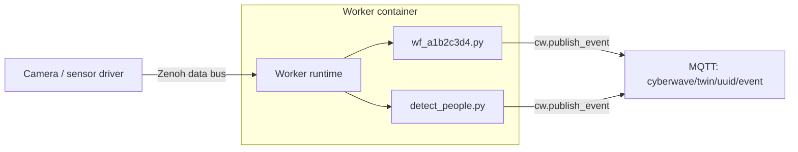

{/* TODO(docs): **STUB DOCUMENT:** This page is intentionally minimal and will be expanded with deeper technical details in a future update. */}

To run a model next to your robot, you use an **edge worker**. An edge worker is a Python module that runs in a worker container on the edge device. Edge Core manages that container for you. You can build the worker without code by activating a workflow, or write it yourself in Python.

## When to use an edge worker

Run on the edge when you need low latency or privacy: frames never leave the site. Run on the [cloud](/overview/tools/cloud-node) when the model needs more compute than the device has. A single [workflow](/feature-reference/workflows) can span both sides.

## How it works



- **One edge device → one worker container → one runtime → many worker modules.** One worker container runs per edge device, not per twin. Workers can consume data from all twins in the environment at the same time.
- Edge Core names the container `cyberwave-worker-{env_uuid[:8]}` and runs it from the `cyberwaveos/edge-ml-worker` image. Edge Core manages the container lifecycle, so you don't need to run it yourself.
- Workers have access to the Zenoh data bus, cached model weights, and all environment twin data.
- The container mounts worker scripts and model weights from the host as read-only volumes.
- Each worker declares **hooks** (callbacks for sensor data) and **model loading** with the `cw` client: `@cw.on_frame`, `cw.models.load`, `cw.publish_event`. No imports needed.

There are two kinds of workers:

| Kind          | Filename prefix       | Managed by                                   |
| ------------- | --------------------- | -------------------------------------------- |
| **Custom**    | anything except `wf_` | You — add/edit freely                        |
| **Generated** | `wf_<uuid8>.py`       | Backend workflow sync — do not edit directly |

Worker files live on the host in `{CONFIG_DIR}/workers/` (default `~/.cyberwave/workers/` on all platforms).

## Run a model

<Tabs>
  <Tab title="No-code (workflows)">
    When a workflow with a **Camera Frame** trigger and a connected **Call Model** node is activated in the UI, the backend generates a `wf_*.py` worker module for that workflow.

    <Steps>
      <Step title="Activate a workflow">
        In the UI, activate a workflow with the chain Camera Frame → Call Model → an edge-compatible model.
      </Step>
      <Step title="Edge Core syncs it">
        Edge Core syncs on next boot, on `CYBERWAVE_WORKER_SYNC_INTERVAL_LOOPS` expiry (default every ~5 minutes), or immediately when a `sync_workflows` MQTT command arrives on the twin's command topic. That command is sent by `cyberwave workflow sync`, by `POST /twins/{uuid}/sync-workflows`, and — for `run_on_edge` workflows — automatically by the activate API itself. So flipping the UI toggle takes effect on the edge within seconds instead of up to one sync interval.
      </Step>
      <Step title="The worker file appears">
        `wf_<uuid8>.py` appears in the workers directory. The file is written atomically. Content-identical files are left untouched to avoid spurious worker container restarts.
      </Step>
      <Step title="The container restarts">
        The WorkerWatcher detects the new file and restarts the worker container.
      </Step>
      <Step title="The hook runs">
        The worker container loads the new module and activates the hook.
      </Step>
    </Steps>

    <Info>
      **Scope of the pull:** Edge Core only pulls `wf_*.py` files for the twins the
      operator selected at install time (the `twin_uuids` list in
      `~/.cyberwave/environment.json`). Workflows targeting twins that are *not* in
      that list stay off this edge even if those twins happen to share its
      fingerprint in metadata — re-run `cyberwave edge install` to change the
      selection.
    </Info>

    To raise alerts from detections, add a `send_alert` node. See [Raising alerts from detections](#raising-alerts-from-detections). To change the generated logic, [eject it](#eject-a-generated-worker) into a custom worker.
  </Tab>
  <Tab title="Python">
    <Steps>
      <Step title="Write the worker">
        ```python
        # ~/.cyberwave/workers/detect_people.py
        # ``cw`` is injected by the worker runtime — no import needed.
        # For IDE support, uncomment: from cyberwave import Cyberwave; cw: Cyberwave

        model = cw.models.load("yolov8n")        # cached, safe to call at module level
        twin_uuid = cw.config.twin_uuid

        @cw.on_frame(twin_uuid, sensor="front")
        def on_frame(frame, ctx):
            results = model.predict(frame, classes=["person"], confidence=0.5)
            for det in results:
                cw.publish_event(twin_uuid, "person_detected", {
                    "confidence": getattr(det, "score", None),
                    "frame_ts": ctx.timestamp,
                })
        ```
      </Step>
      <Step title="Add it to the device">
        ```bash
        cyberwave worker add detect_people.py  # copy a file into the workers dir
        ```
        `cyberwave worker add` chmods the file to `0644` so the container can read it.
      </Step>
      <Step title="Restart the worker container">
        After adding or removing a worker file, restart the worker container so the change takes effect:

        ```bash
        cyberwave-edge-core worker restart
        ```

        {/* TODO(docs): sources disagree: the old Edge worker container page says Edge Core hot-reloads the workers directory every ~15 s (no manual restart needed); this page says to restart the container after adding or removing a file. */}
      </Step>
      <Step title="Check that it runs">
        ```bash
        cyberwave worker status   # show worker files + container state
        cyberwave worker logs     # stream worker container logs
        ```
        If the hook never fires, see [Troubleshooting](#troubleshooting).
      </Step>
    </Steps>

    <Accordion title="Another example: only alert when a person is close">
      Inside the container, worker files are mounted at `/app/workers/`.

      ```python
      # /app/workers/detect_people.py — loaded by the runtime automatically

      model = cw.models.load("yolov8n")
      twin_uuid = cw.config.twin_uuid

      @cw.on_frame(twin_uuid, sensor="front")
      def detect_people(frame, ctx):
          results = model.predict(frame, classes=["person"], confidence=0.5)
          for det in results:
              if det.area_ratio > 0.3:
                  cw.publish_event(twin_uuid, "person_too_close", {
                      "detections": len(results),
                      "frame_ts": ctx.timestamp,
                  })
      ```
    </Accordion>
  </Tab>
</Tabs>

---

## Worker API

### Hook decorators

Register callbacks for sensor streams. Hooks are passive at import time — the runtime activates them.

| Decorator | Channel | Sensor kwarg |
|---|---|---|
| `@cw.on_frame(uuid, sensor=None)` | `frames/{sensor}` (wildcard when omitted) | `sensor` |
| `@cw.on_depth(uuid, sensor=None)` | `depth/{sensor}` (wildcard when omitted) | `sensor` |
| `@cw.on_audio(uuid, sensor=None)` | `audio/{sensor}` (wildcard when omitted) | `sensor` |
| `@cw.on_pointcloud(uuid, sensor=None)` | `pointcloud/{sensor}` (wildcard when omitted) | `sensor` |
| `@cw.on_lidar(uuid, sensor=None)` | `lidar/{sensor}` (wildcard when omitted) | `sensor` |
| `@cw.on_imu(uuid)` | `imu` | — |
| `@cw.on_joint_states(uuid)` | `joint_states` | — |
| `@cw.on_gps(uuid)` | `gps` | — |
| `@cw.on_battery(uuid)` | `battery` | — |
| `@cw.on_data(uuid, channel)` | custom | — |

All callbacks receive `(sample_payload, ctx)` where `ctx` is a `HookContext` with `timestamp`, `channel`, `sensor_name`, `twin_uuid`, and `metadata`.

<Note>
  Passing `sensor=None` (or omitting it) subscribes to every sensor of that
  type on the twin — the SDK constructs a `frames/**` (or `depth/**`, etc.)
  wildcard key expression. `ctx.sensor_name` is populated from the observed
  publish key so a single handler can disambiguate multi-sensor twins.
  Pin `sensor="<name>"` (e.g. `"color_camera"`) when you need to target one
  specific sensor — the name must match what the twin asset declares.
</Note>

The `fps` parameter on `@cw.on_frame` controls the frame sampling rate.

### Model loading

```python
model = cw.models.load("yolov8n")                    # auto-detect runtime
model = cw.models.load("my-model", runtime="ultralytics", device="cuda:0")
result = model.predict(frame, confidence=0.5, classes=["person"])
```

`cw.models.load()` caches models, so it's safe to call at module level.

### Publishing events

```python
cw.publish_event(twin_uuid, "event_type", {"key": "value"})
```

Publishes to `cyberwave/twin/{uuid}/event` via MQTT. The payload matches the backend `mqtt_consumer.handle_business_event()` schema.

### Runtime entrypoint

Worker modules never call `cw.run_edge_workers()` themselves. The container entrypoint does:

```python
from cyberwave import Cyberwave
cw = Cyberwave(api_key=...)
cw.run_edge_workers()  # loads workers, wires hooks, blocks
```

---

## Workflow-generated workers

### Raising alerts from detections

`call_model` no longer publishes alerts on its own (the legacy `emit_event` config was removed). To raise alerts from a `camera_frame → call_model` chain, wire an explicit `send_alert` node downstream. Optional gating nodes preserve the previous `emit_mode` / cooldown semantics:

- **`detection_event_gate`** — class filtering plus `on_enter` (new classes only) / `on_change` (count changes) modes.
- **`timed_condition`** (`mode: debounce`, `cooldown_s: <seconds>`) — minimum delay between consecutive fires, replacing the old `cooldown_seconds`.

A typical edge chain compiles to a worker that calls `cw.publish_alert(...)` only when the gate and timer agree:

```
camera_frame → call_model → detection_event_gate → timed_condition → send_alert
```

`send_alert` whose immediate upstream is `call_model` defaults to `force=True`. The per-frame publish loop bypasses the backend's content-hash dedupe, so two consecutive identical detections still raise distinct alerts. Set `parameters.force` to `false` on the `send_alert` node to opt back into the dedupe. When a gate or `timed_condition` sits between `call_model` and `send_alert`, the heuristic backs off and the long-standing `force=False` default applies (the gate already debounces).

A `timed_condition` placed downstream of `call_model` _without_ a trailing `send_alert` is inert — the legacy implicit-alert path it used to gate is gone. The compiler attaches a warning to the resulting compilation so the silent-skip case is visible in `cyberwave workflow sync` preflight output. The worker still ships and runs inference, but nothing is published until you wire the `send_alert`.

See the [`emit_event` migration table](/feature-reference/workflows#migrating-from-emit_event) for the field-by-field mapping (including the `force=True` default).

### Removing a workflow from the edge

{/* TODO(docs): **STUB:** This subsection will be expanded with a deeper diagram of the remove path. */}

**Deactivating, soft-deleting, or flipping `run_on_edge` off** publishes a surgical `remove_workflow_worker` MQTT command to each affected twin command topic, naming the specific worker file(s) to unlink. Edge Core deletes the matching `wf_*.py` and immediately reconciles the worker container lifecycle. The workflow stops running on the device within seconds rather than waiting up to one full periodic interval (~5 minutes) plus the bulk-sync two-strikes cleanup. The same path is used for the cascade cases (workspace or environment deletion that removes the workflow). The periodic reconcile remains the correctness backstop if the MQTT publish is dropped.

### Eject a generated worker

A generated `wf_*.py` worker can be **ejected** into a custom worker when you need to customise the logic beyond what the workflow graph supports.

```bash
# 1. Copy the generated worker to a new custom name
cp ~/.cyberwave/workers/wf_a1b2c3d4.py \
   ~/.cyberwave/workers/my_detector.py

# 2. Edit the new custom worker
nano ~/.cyberwave/workers/my_detector.py

# 3. Deactivate the originating workflow in the UI
#    (this removes wf_a1b2c3d4.py on the next sync)
```

**Ownership after ejection:**

- The `wf_*.py` file is **deleted** on the next edge sync (because the workflow was deactivated).
- Your `my_detector.py` is **untouched** by edge sync — you own it.
- Edge sync never writes to files that do not start with `wf_`.

<Warning>
  Do not edit `wf_*.py` files directly. They are overwritten on the next sync. Always eject first.
</Warning>

### Generated worker format

For reference, here is what a generated worker looks like (with `on_enter` emit mode and cooldown):

```python
"""
Generated edge worker for workflow: Alert on Person
Workflow UUID: a1b2c3d4-...

Auto-generated by WorkerCodegen — DO NOT EDIT.
To customise this worker, eject it:
  cp wf_a1b2c3d4.py alert_on_person.py
"""

import time

# ``cw`` is injected by the worker runtime — no import needed.
# For IDE support, uncomment: from cyberwave import Cyberwave; cw: Cyberwave

yolov8n = cw.models.load("yolov8n.pt")  # type: ignore[name-defined]  # noqa: F821

_last_emit_ts_0 = 0.0
_prev_labels_0 = set()

@cw.on_frame("twin-uuid", sensor="front", fps=5)  # type: ignore[name-defined]  # noqa: F821
def on_frame_a1b2c3d4_0(frame, ctx):
    """Camera frame handler for workflow 'Alert on Person'."""
    global _last_emit_ts_0, _prev_labels_0
    results = yolov8n.predict(frame, classes=["person"], confidence=0.5)
    current_labels = {
        getattr(d, 'label', getattr(d, 'class_name', ''))
        for d in results
    }
    new_labels = current_labels - _prev_labels_0
    if not new_labels:
        _prev_labels_0 = current_labels
        return
    now = time.monotonic()
    if now - _last_emit_ts_0 < 5.0:
        return
    _prev_labels_0 = current_labels
    _last_emit_ts_0 = now
    for det in results:
        label = getattr(det, 'label', getattr(det, 'class_name', ''))
        if label not in new_labels:
            continue
        cw.publish_event(  # type: ignore[name-defined]  # noqa: F821
            "twin-uuid",
            "person_detected",
            {
                "severity": "WARNING",
                "model": "yolov8n.pt",
                "confidence": getattr(det, 'score', None),
                "frame_ts": ctx.timestamp,
            },
        )
```

Generated workers follow the same contract as handwritten workers: `cw` is injected as a builtin, models are loaded at module level, and events are published with `cw.publish_event`.

---

## Choose a model

### Declare model requirements

Declare model dependencies in `cyberwave.yml` inside the workers directory:

```yaml
models:
  - yolov8n
  - background-subtraction
```

Edge Core pre-downloads listed models before starting the worker container. Models are also auto-detected from `cw.models.load("...")` calls in worker Python files. See [Model cache](/feature-reference/workflows/workers/model-cache) for how weights are cached.

### Pick the model format

Each catalog model declares an **edge runtime** that tells the worker how to load the checkpoint. The runtime selector lives in the model editor (`/models` → "Add Model" or "Edit"). It is also accepted as a typed `edge_runtime` field on `POST /api/v1/mlmodels` and `PUT /api/v1/mlmodels/{uuid}`.

The well-known runtimes mirror the loaders in the Cyberwave Python SDK's `cyberwave.models.runtimes` registry:

| Runtime | Extension | Loader |
|---|---|---|
| `ultralytics` | `.pt` | YOLOv5/8/11 via the Ultralytics package |
| `onnxruntime` | `.onnx` | ONNX Runtime (CPU, CUDA EP on the GPU image) |
| `opencv` | `.xml` / `.caffemodel` | OpenCV Haar / DNN models |
| `tflite` | `.tflite` | TensorFlow Lite |
| `torch` | `.pt` / `.pth` | TorchScript / raw PyTorch |
| `tensorrt` | `.engine` / `.trt` | TensorRT engines (GPU image only) |
| `whisper_cpp` | `.gguf` / `.bin` | Whisper.cpp speech-to-text on CPU edge devices |
| `faster_whisper` | CTranslate2 weights (HF cache) | faster-whisper STT on edge CPU/GPU |
| `hailo` | `.hef` | Hailo accelerator (`hailo_platform`) on Pi 5 + AI HAT+ / Pi AI Kit |

Custom values are accepted via the editor's "Other" entry. They are used today for framework-specific identifiers like `sam2`, `sam3`, and `depth_anything_v2` that don't have an SDK loader yet but still need to round-trip through the catalog.

`GET /api/v1/mlmodels/edge-runtimes` returns the current well-known list (no auth required), so external tools can mirror the dropdown without hard-coding it.

<AccordionGroup>
  <Accordion title="Detection post-processing (NMS and caps)">
    ONNX YOLO postprocessing applies per-class non-max suppression with a default IoU threshold of `0.7`. So swapping `yolov8s.pt` for `yolov8s.onnx` produces the same number of boxes per object instead of a cluster of overlapping anchors. Override per call with `model.predict(frame, iou=0.5)` (stricter) or `iou=1.0` (raw output, no suppression).

    NMS-free detectors (YOLO26's default one-to-one head, YOLOv10) emit `[max_det, 6] = [x1, y1, x2, y2, conf, class_id]`. The SDK's ONNX runtime detects this layout automatically and parses it without the anchor-decoding step. The model's one-to-one head is supposed to already be deduplicated, but some exports (open-vocabulary heads especially) can still emit many near-duplicate boxes for one object, so the same `iou` NMS also runs here as a safety net. End-to-end pose / segmentation exports are not decoded yet. Re-export those tasks with `end2end=False` until the e2e pose branch lands.

    Every detection result is also capped at `max_detections_per_class` (default `30`) highest-confidence boxes per label, applied after NMS. This is a backstop for models whose suppression doesn't fully collapse duplicates (open-vocabulary heads like YOLOE are the common case). Pass `model.predict(frame, max_detections_per_class=None)` to disable it. The Ultralytics runtime also defaults every call to `end2end=False`, so real NMS runs on the one-to-many head instead of trusting a checkpoint's self-reported "already deduplicated" flag. Checkpoints with only a one-to-one head (fused `.pt`, TensorRT, some ONNX exports) fall back to `end2end=True` automatically.
  </Accordion>
  <Accordion title="YOLO ONNX catalog">
    The public catalog ships ONNX twins for the most common YOLO entries. Cyberwave hosts the exported weights at `https://static.cyberwave.com/ml_models/{name}.onnx`, so edge nodes can fetch them with no Ultralytics CDN dependency. They are roughly 2× faster on CPU than the `.pt` build:

    | Family | Sizes | Tasks |
    |---|---|---|
    | YOLOv8 | n, s | detect; plus pose (n only) |
    | YOLO26 | n, s, m, l, x | detect, pose |

    Pick `Edge Runtime: ONNX Runtime` in the model editor (or `metadata.edge_runtime = "onnxruntime"` via the API) when registering a private fine-tune that you've exported via `YOLO("…").export(format="onnx")`. The SDK's `OnnxRuntime` reads `names` and `kpt_shape` from the ONNX `custom_metadata_map`, so labelled detections and keypoints work out of the box.

    Segmentation, OBB, and classification ONNX exports are not yet supported by the SDK runtime. Use the `.pt` (`ultralytics`) variants for those tasks.
  </Accordion>
  <Accordion title="YOLO Hailo catalog">
    For Hailo-accelerated edge nodes (Raspberry Pi 5 + AI HAT+ and the older Pi AI Kit), the catalog also ships pre-compiled YOLO HEFs straight from the Hailo Model Zoo. Each upstream YOLO checkpoint gets two sibling rows — one per Hailo architecture — because HEFs are hardware-locked:

    | Slug | Family | Arch | Edge target |
    |---|---|---|---|
    | `yolov6n_h8` / `yolov6n_h8l` | YOLOv6 Nano | Hailo-8 / Hailo-8L | 26 / 13 TOPS |
    | `yolov8n_h8` / `yolov8n_h8l` | YOLOv8 Nano | Hailo-8 / Hailo-8L | 26 / 13 TOPS |
    | `yolov8s_h8` / `yolov8s_h8l` | YOLOv8 Small | Hailo-8 / Hailo-8L | 26 / 13 TOPS |
    | `yolov8m_h8` / `yolov8m_h8l` | YOLOv8 Medium | Hailo-8 / Hailo-8L | 26 / 13 TOPS |

    Slugs use the `_h8` / `_h8l` suffix on purpose: `cw.models.load("yolov8s_h8")` is enough to route through the SDK's `hailo` runtime, with no extra arguments. Pick the row that matches your edge target. A Hailo-8 HEF will refuse to run on a Hailo-8L (and vice versa).

    If you pick the wrong sibling, Edge Core catches it before the download starts. A Gate-3 preflight probes the connected accelerator with `hailortcli fw-control identify` and refuses to fetch a HEF whose `metadata.hw_arch` disagrees with the device, naming the correct sibling in the error message. The preflight is silent when `hailortcli` is not installed on the host. Install it via `apt install hailo-all` (or the matching HailoRT package) to enable the check.
  </Accordion>
  <Accordion title="Edge speech-to-text">
    Seeded Whisper.cpp STT models can run from `Audio Track -> Call Model` workflows on Raspberry Pi 4-class devices. The generated worker passes the audio chunk and seeded `download_url` into the local `whisper_cpp` runtime, so the first run downloads missing weights into the Cyberwave model cache. Downstream nodes can use `text`, `transcribed_text`, and `segments`.

    English GGML checkpoints: **Tiny EN**, **Base EN**, and **Small EN** (Q5_1). Multilingual checkpoints: **Tiny Multilingual** and **Base Multilingual** — hybrid deployment with `edge_runtime: whisper_cpp` on edge missions and whisper cloud-node fallback (`openai/whisper-tiny` / `openai/whisper-base`) on cloud missions. Use multilingual models when the spoken language is unknown or mixed.

    Hybrid **Faster Whisper** catalog entries (`faster_whisper` runtime) run on-device when the workflow mission executes on the edge. Cloud missions use the whisper cloud node with the same OpenAI model aliases (`openai/whisper-tiny` → `tiny.en`, etc.). Prefer **Faster Whisper Tiny EN** for real-time English streams. Use **Whisper Tiny Multilingual Q5_1** for multilingual edge STT without CTranslate2.
  </Accordion>
</AccordionGroup>

### Model weights resolution

For each required model, Edge Core resolves weights in this order:

1. **Local cache (intact).** If `~/.cyberwave/models/{model_id}/...` is present and its SHA-256 matches the manifest, it is used directly.
2. **Cyberwave-hosted signed URL.** If the catalog entry has a checkpoint mirror, Edge Core fetches a signed URL via `GET /api/v1/mlmodels/{uuid}/weights` and downloads from our private bucket.
3. **Upstream weights URL.** If no Cyberwave mirror exists, Edge Core falls back to the public `download_url` from the catalog (e.g. an official Ultralytics release).
4. **Stale cache fallback.** If every download attempt fails but the local file is intact, Edge Core returns the cached file with a warning. This keeps workers running across transient network failures and on permanently air-gapped sites.

On air-gapped sites, you can pre-stage weights by copying them to `~/.cyberwave/models/{model_id}/`. Edge Core computes a SHA-256, infers the runtime from the file extension (`.pt`, `.onnx`, `.engine`/`.trt`, `.tflite`, `.pth`, `.xml`), and writes a sidecar `metadata.json` on the next worker start. To update a pre-staged model, overwrite the file in place. Edge Core re-stamps the manifest from disk on the next call (no re-download attempted). Pre-staged files are never auto-overwritten by catalog updates. To force a re-download from Cyberwave, evict the model directory (`rm -rf ~/.cyberwave/models/{model_id}`).

---

## Container images and hardware

{/* TODO(docs): sources disagree: the old Container Image section says Edge Core pulls the worker image automatically in the background on first startup; the old "How edge workers work" page says the image is not pulled at all when no workflow is active (kept under Lifecycle). */}

Edge Core pulls the worker image for you, in the background, so `cyberwave edge install` stays fast and non-blocking. There is no need to wait for the image download during installation.

Release channels:

| Tag          | Description                  |
| ------------ | ---------------------------- |
| `latest`     | Stable CPU release           |
| `dev`        | Development CPU build        |
| `latest-gpu` | Stable with NVIDIA CUDA      |
| `dev-gpu`    | Development with NVIDIA CUDA |

### Image variants

The worker image is published in four variants on Docker Hub:

| Tag | Base | Accelerator | Architectures | Use when |
|---|---|---|---|---|
| `cyberwaveos/edge-ml-worker:<tag>` | `ubuntu:24.04` | CPU (`onnxruntime`) | `linux/amd64`, `linux/arm64` | No GPU available, or inference is light enough for CPU. |
| `cyberwaveos/edge-ml-worker:<tag>-gpu` | `nvidia/cuda:12.6.3-runtime-ubuntu24.04` | NVIDIA discrete (`onnxruntime-gpu`) | `linux/amd64` | Edge device has an NVIDIA GPU and `nvidia-container-toolkit` installed. |
| `cyberwaveos/edge-ml-worker:<tag>-jetson` | `ubuntu:24.04` (arm64) | NVIDIA Tegra iGPU (PyTorch + ONNX Runtime GPU, Jetson AI Lab cu129 wheels; CUDA injected by host at runtime) | `linux/arm64` | Jetson Orin on JetPack 7 (Ubuntu 24.04 / L4T r38). JetPack 6 hosts are not supported. |
| `cyberwaveos/edge-ml-worker:<tag>-hailo` | `cyberwaveos/edge-ml-worker:<tag>` | Hailo-8 / Hailo-8L (`hailo_platform`) | `linux/arm64` | Edge device has a Hailo accelerator exposed at `/dev/hailo0` (e.g. Raspberry Pi 5 + AI HAT+). |

All four variants ship the same Python API. PyTorch/Ultralytics models pick the device automatically. ONNX models gain `CUDAExecutionProvider` only on the `-gpu` variant. `.hef` files load through the `hailo` runtime only on the `-hailo` variant.

### How Edge Core picks a variant

Edge Core detects the NVIDIA container runtime and passes `--gpus all` to the worker container when available. It selects the variant automatically based on host capabilities:

* **Jetson host detected** (`/etc/nv_tegra_release` present) → appends `-jetson` and adds `--gpus all`. This wins over the `-gpu` branch: on Jetson the nvidia-container-runtime is present too, but the amd64 `-gpu` blob has the wrong `libcuda.so` ABI (desktop/server CUDA vs Tegra CUDA).
* **NVIDIA container runtime detected (not Jetson)** → appends `-gpu` to the configured worker image tag and adds `--gpus all`.
* **`/dev/hailo0` present and no GPU runtime** → appends `-hailo`, adds `--device /dev/hailo0:/dev/hailo0:rwm` and `--group-add hailo` (on HailoRT \< 4.20 hosts), and sets `CYBERWAVE_REQUIRED_DEVICES=/dev/hailo0` so the image's Gate-4 entrypoint fails fast if the passthrough is missing.
* **None** → uses the CPU base image.

Jetson takes precedence over the amd64 GPU variant, and GPU takes precedence over Hailo when both are available on the same host. Mixing them in a single deployment is not supported. If a variant cannot be pulled (e.g. the `-jetson` image isn't published for your channel yet), Edge Core falls back to the CPU image and logs the demotion.

<AccordionGroup>
  <Accordion title="Jetson details">
    The `-jetson` variant uses PyTorch/torchvision/torchaudio and `onnxruntime-gpu` wheels from the [Jetson AI Lab devpi index](https://pypi.jetson-ai-lab.io/jp6/cu129/) (Orin `sm_87` builds), not the amd64 `-gpu` variant's index. The image base is `ubuntu:24.04`; NVIDIA has not yet published an `l4t-jetpack` image for JP7. nvidia-container-runtime injects the host's CUDA driver at container start. The image itself bundles the matching CUDA 12.9 userspace runtime libraries (`libcudart`, `libcublas`, cuDNN), since the Jetson wheels link against system CUDA rather than bundling it. ONNX Runtime exposes `CUDAExecutionProvider` on Jetson, same as the `-gpu` variant.

    **JetPack 6 hosts are not supported.** JetPack 6's CUDA driver predates what's needed to run a CUDA 12.9 runtime, so only JetPack 7 hosts should pull this tag. Edge Core reads the L4T release from `/etc/nv_tegra_release` and starts a JetPack 6 board on the plain (CPU, multi-arch) tag instead, logging a warning. `CYBERWAVE_JETSON_ALLOW_UNSUPPORTED_L4T=1` forces the `-jetson` tag anyway. This is decided when the worker container is created, so a board already running a `-jetson` worker keeps it across an Edge Core upgrade. Remove the container once (`docker rm -f cyberwave-worker`) to pick up the new selection.

    {/* TODO(docs): sources disagree: the container is named `cyberwave-worker-{env_uuid[:8]}` in the overview of the old Edge worker container page, but its Jetson note removes `cyberwave-worker`. */}
  </Accordion>
  <Accordion title="Hailo details">
    The `-hailo` variant compiles HailoRT (`libhailort` + `hailortcli` + `pyhailort`) from the MIT-licensed upstream source at [`hailo-ai/hailort`](https://github.com/hailo-ai/hailort) at a pinned tag. The LGPL-2.1 GStreamer plugin (`hailonet`) is left out of the build. The companion kernel driver ([`hailo-ai/hailort-drivers`](https://github.com/hailo-ai/hailort-drivers)) is installed on the host (e.g. via `apt install hailo-all` on Raspberry Pi OS), not in the container. Its minor version must match the userspace lib baked into the image.
  </Accordion>
</AccordionGroup>

---

## Lifecycle

Edge Core starts the worker container only when at least one workflow is active for the connected twins (i.e. the latest sync produced one or more `wf_*.py` files in `{config_dir}/workers/`). When no active workflow exists, the `cyberwaveos/edge-ml-worker` image is not pulled at all.

{/* TODO(docs): sources disagree: this start condition only counts `wf_*.py` files, but the custom-worker flow (`cyberwave worker add`, hot-reload) implies custom workers run without an active workflow. Confirm whether custom files alone start the container. */}

Workflow activations and deactivations are picked up automatically:

- **At startup:** after the workflow sync step, the worker container is started if files exist. Otherwise startup logs `No active workflows for connected twins; worker container not started` and proceeds.
- **At runtime:** every ~5 minutes the workers directory is re-synced. The worker container is started when files appear and stopped when files disappear. Both transitions are idempotent.
- **Immediately on activate:** when a `run_on_edge` workflow is activated, the backend publishes a `sync_workflows` MQTT command on each referenced twin's command topic. Edge Core runs an immediate sync and lifecycle reconcile, so the new `wf_*.py` lands within seconds.
- **Immediately on remove (deactivate / soft-delete / `run_on_edge` flip off):** the backend publishes a `remove_workflow_worker` MQTT command and Edge Core unlinks the file within seconds. See [Removing a workflow from the edge](#removing-a-workflow-from-the-edge).

`cyberwave edge sync-workflows --twin-uuid <twin_uuid>` (or `cyberwave workflow sync <workflow_uuid>`) triggers an immediate sync via MQTT, which reuses the same lifecycle path on the next reconcile.

### Hot-reload on file changes

Edge Core monitors the workers directory every ~15 seconds. When `.py` files are added, removed, or modified, the worker container is automatically restarted with the updated set of workers.

A minimum cool-down of 10 seconds between successive automatic restarts prevents rapid churn when files are written incrementally.

### Health monitoring

Edge Core continuously monitors the worker container:

- **Restart accounting:** every restart is recorded with timestamp and reason.
- **Circuit-breaker:** after 5 restarts in 5 minutes, automatic restarts are suppressed until the window clears. Run `cyberwave worker health` to inspect the state.
- **Spontaneous exit detection:** if the container exits without a deliberate restart, a warning is logged.

---

## Configuration

| Env var | Default | Purpose |
|---|---|---|
| `CYBERWAVE_TWIN_UUID` | — | Twin UUID, available as `cw.config.twin_uuid`. |
| `CYBERWAVE_WORKERS_DIR` | `/app/workers` | Workers directory inside the container. |
| `CYBERWAVE_MODEL_DIR` | `/app/models` | Model weights directory inside the container. |
| `CYBERWAVE_MODEL_DEVICE` | auto-detect | Default inference device. Unset = auto-detect, which probes both a conv2d (cuDNN) and a matmul (cuBLAS) on the GPU and falls back to `cpu` if either fails — the warning names which one. Typical causes: Pascal/sm_61 on cuDNN 9, an arch missing from the torch build, or a driver/runtime mismatch that breaks `cublasCreate`. Set to `cuda:0` to force GPU, or `cpu` to skip the probe. |
| `CYBERWAVE_WORKER_INPUT_RESOLUTION` | — | Downscale incoming frames before they reach hooks, e.g. `640x480`. See [Performance tuning](#performance-tuning). |
| `CYBERWAVE_WORKER_SYNC_INTERVAL_LOOPS` | ~5 minutes | Controls when the periodic workflow sync runs. |
| `CYBERWAVE_JETSON_ALLOW_UNSUPPORTED_L4T` | — | Set to `1` to force the `-jetson` tag on a JetPack 6 board. |
| `ZENOH_SHARED_MEMORY` | disabled | Zero-copy frame transport. See [Shared memory transport](#shared-memory-transport). |

### Tune log verbosity

{/* TODO(docs): **STUB SECTION:** This page will be expanded with a per-component log-routing diagram. */}

Worker containers and edge-driver containers have separate log-level knobs, so you can raise one to `DEBUG` without drowning in the other.

| Variable                     | Applies to                     | Default | Notes                                                                                                                              |
| ---------------------------- | ------------------------------ | ------- | ---------------------------------------------------------------------------------------------------------------------------------- |
| `CYBERWAVE_WORKER_LOG_LEVEL` | Worker container only          | `INFO`  | Wins over `CYBERWAVE_EDGE_LOG_LEVEL` when set. Raise to `DEBUG` to surface per-frame workflow trace lines (one per node per tick). |
| `CYBERWAVE_EDGE_LOG_LEVEL`   | Edge drivers + worker fallback | `INFO`  | Read by drivers and by the worker when `CYBERWAVE_WORKER_LOG_LEVEL` is unset.                                                      |

Edge Core auto-forwards any `CYBERWAVE_*` env var it sees in its own process environment into each worker container at `docker run` time. So the same knob works whether you set it in the systemd unit, the CLI install env, or the shell. Workers print one INFO line at startup naming the resolved level and the variable that supplied it (e.g. `Worker runtime starting with log level=INFO (source=default)`), so you can verify the knob took effect without inspecting the container.

In steady state, per-node workflow trace lines (`Workflow node started: <uuid>`, `Workflow node finished: <uuid>`) log at `DEBUG`, not `INFO`. They fire 20–30×/s on frame-driven workers and would otherwise dominate the log. Errors (`Workflow node failed`) and per-execution boundaries (`Workflow execution finished`) stay visible at the default level.

The generated workflow logger is hierarchical (`cyberwave.workflows.<workflow-uuid>`), so you can also tune workflow verbosity per instance from inside a worker without touching the root logger:

```python
import logging
logging.getLogger("cyberwave.workflows").setLevel(logging.WARNING)
```

---

## Performance tuning

### Model warm-up

The worker runtime automatically runs two dummy inferences on each loaded model at startup to eliminate cold-start latency (JIT compilation, memory allocation). Cold vs warm latency is logged.

You can also warm up models explicitly:

```python
model = cw.models.load("yolov8n")
cold_ms, warm_ms = model.warm_up(input_shape=(640, 640, 3))
```

### Frame resolution scaling

Set `CYBERWAVE_WORKER_INPUT_RESOLUTION` to downscale incoming frames before they reach your worker hooks. This reduces inference time on constrained devices without changing the camera driver's publish resolution.

```bash
export CYBERWAVE_WORKER_INPUT_RESOLUTION=640x480
```

### Shared memory transport

Zenoh shared-memory (SHM) transport offers zero-copy frame delivery between the camera driver and worker containers on the same host. Edge Core leaves `ZENOH_SHARED_MEMORY` **disabled by default**. SHM between Docker containers requires them to share an IPC namespace via `--ipc=host`, which weakens container isolation and has historically been a source of instability in production.

To opt in, enable the flag on **both** the publisher and any same-host consumer. Give each container a shared IPC namespace (`--ipc=host`) and a raised locked-memory limit (`memlock=-1`). The default 8 MB cap is too small for a frame pool, and without it the transport silently falls back to copy.

```yaml
# docker-compose fragment — publisher + same-host consumer
services:
  camera-driver:
    ipc: host                 # shared /dev/shm + IPC namespace
    ulimits:
      memlock: -1
    environment:
      ZENOH_SHARED_MEMORY: "true"
  ml-worker:
    ipc: host
    ulimits:
      memlock: -1
    environment:
      ZENOH_SHARED_MEMORY: "true"
```

Under Edge Core, set `ZENOH_SHARED_MEMORY=true` once in its environment and it propagates the flag to the driver and worker containers. With the SDK directly, set it on each container (or pass `ZenohBackend(shared_memory=True)`). Zero-copy applies only to frame-sized payloads. Small messages (joint states, etc.) always copy. Optional publisher knobs:

| Variable | Default | Purpose |
|---|---|---|
| `ZENOH_SHM_POOL_BYTES` | 64 MB | Size of the shared-memory pool. Raise for large frames or deep in-flight buffering. |
| `ZENOH_SHM_MIN_BYTES` | 4096 | Payloads below this size skip SHM and publish via copy. |
| `ZENOH_SHM_ON_EXHAUSTION` | `copy` | Backpressure when the pool is full: `copy` (guaranteed delivery, latency grows under overload) or `drop` (skip the frame, stay low-latency — for live video). |

If the pool can't be created, publishing degrades to the copy path with a warning rather than failing. When it's exhausted by a slow consumer, the `ZENOH_SHM_ON_EXHAUSTION` policy decides between copying and dropping the frame. The pool is allocated per frame whether or not a subscriber can use zero-copy, so enable SHM only when a same-host, SHM-capable consumer is actually reading the stream.

<Warning>
**A healthy-looking publisher does not prove zero-copy delivery.** The pool is created and used successfully even when no consumer can map it — for example if the containers omit `ipc: host`, each gets its own private `/dev/shm`. In that case the publisher reports SHM enabled and its `shm_frames` counter climbs, while every consumer silently receives ordinary wire copies and you get none of the latency benefit.

Those counters are publish-side intent only. The single source of truth is the **receiving** end: a sample is genuinely zero-copy only when `sample.payload.as_shm()` is not `None`. Verify there once when rolling SHM out, rather than trusting the publisher's stats.
</Warning>

#### Consuming the stream from your own process

The SHM path isn't specific to the ML worker — **any Zenoh peer on the same host can read a driver's frames zero-copy**. To consume from your own process:

- **Run it on the same host.** If it's containerized, launch it with `--ipc=host` (or `--ipc=container:<driver>`) so it shares the IPC namespace. A process running directly on the host already qualifies.
- **Enable SHM in its Zenoh session:** `ZENOH_SHARED_MEMORY=true` via the SDK, or `transport/shared_memory/enabled=true` on a raw Zenoh session. A consumer that leaves SHM off still receives every frame, just copied over loopback instead of zero-copy.
- **Subscribe to the driver's channel.** With the SDK, use `DataBus.subscribe(...)` — it resolves the key for you. `memlock=-1` is only needed if your process *also* publishes SHM.

Read-side note: a **Python** consumer (SDK or raw `eclipse-zenoh`) receives each frame as a copy. The zero-copy is the transport hop, so it still cuts latency and jitter but not the final ingest copy. A native **C++/Rust** Zenoh consumer can map the shared buffer and read it zero-copy end-to-end.

To measure hot-path performance on a device, use [Edge Bench](/feature-reference/workflows/workers/bench).

---

## CLI reference

### Worker commands

```bash
cyberwave worker list                   # list installed workers (shows origin)
cyberwave worker add detect_people.py  # copy a file into the workers dir
cyberwave worker remove detect_people  # remove a worker (with or without .py)
cyberwave worker start                 # start the worker container
cyberwave worker stop                  # stop the worker container
cyberwave worker restart               # restart (re-scans workers, re-downloads models)
cyberwave worker status                # show worker files + container state
cyberwave worker health                # show detailed restart history and circuit-breaker state
cyberwave worker logs                  # stream worker container logs
cyberwave worker monitor               # live resource/throughput dashboard
cyberwave worker doctor                # diagnose silent failure modes
```

<Tip>
  The container commands (`start`, `stop`, `restart`, `status`, `health`, `logs`) are also available via `cyberwave-edge-core worker …` if you prefer to use the edge-core CLI directly.
</Tip>

`cyberwave worker list` shows the **origin** of each worker:

```
Installed Workers (~/.cyberwave/workers)
┌───────────────────────────┬──────────┬────────────────────────────┬───────┐
│ Name                      │ Origin   │ File                       │ Size  │
├───────────────────────────┼──────────┼────────────────────────────┼───────┤
│ detect_people             │ custom   │ detect_people.py           │ 512 B │
│ wf_a1b2c3d4               │ workflow │ wf_a1b2c3d4.py             │ 1.2 kB│
└───────────────────────────┴──────────┴────────────────────────────┴───────┘
```

### Monitor workers

{/* TODO(docs): **STUB:** This section will be expanded with screenshots and deeper guidance. */}

`cyberwave worker monitor` opens a live-updating terminal dashboard for the running worker container.

```bash
cyberwave worker monitor               # default 2s refresh
cyberwave worker monitor --update 1    # 1s refresh
cyberwave worker monitor -c <name>     # explicit container
```

The dashboard shows:

| Section              | Metrics                          | Source                        |
| -------------------- | -------------------------------- | ----------------------------- |
| **Resource Usage**   | CPU %, memory, network I/O, PIDs | `docker stats`                |
| **GPU**              | Utilization, memory, temperature | `nvidia-smi` (Linux only)     |
| **Zenoh Throughput** | Per-channel msgs/s, totals       | SDK instrumentation via Zenoh |
| **Worker Hooks**     | Per-hook frame count, drop rate  | SDK instrumentation via Zenoh |
| **Model Inference**  | Avg / P95 / P99 latency, count   | SDK instrumentation via Zenoh |

**Requirements:**

- Docker must be running on the host.
- For Zenoh throughput, hooks, and model metrics: `eclipse-zenoh` must be installed (`pip install eclipse-zenoh`).
- GPU metrics require NVIDIA drivers and `nvidia-smi` on Linux. macOS shows "N/A" for GPU.

### Workflow commands

The `cyberwave workflow` command group lets you manage workflows from the terminal:

```bash
cyberwave workflow list                # list workflows with status and target twin(s)
cyberwave workflow list --json         # JSON output
cyberwave workflow show                # interactive selection, shows nodes and twins
cyberwave workflow show <uuid>         # show specific workflow
cyberwave workflow create -n "Name"    # create a workflow
cyberwave workflow create --template motion-detection
cyberwave workflow activate            # activate (interactive selector)
cyberwave workflow deactivate          # deactivate (interactive selector)
cyberwave workflow sync                # sync workflow to edge device(s) via MQTT
cyberwave workflow sync --edge-active  # restrict selector to active edge workflows
cyberwave workflow sync <uuid>         # sync specific workflow
cyberwave workflow delete --yes        # delete (skip confirmation)
```

All subcommands accept `--base-url` / `-u` to override the API URL (e.g. `http://192.168.10.101:8000`). When a UUID is omitted, an interactive arrow-key selector is shown.

The `sync` command reads the workflow's `camera_frame` trigger nodes to discover which twin(s) it targets. It then sends a `sync_workflows` MQTT command to each twin's edge node, which triggers an immediate HTTP pull of the latest worker files.

---

## Troubleshooting

### `@cw.on_frame` hook never fires

{/* TODO(docs): **STUB SECTION:** The most common reasons a worker container looks healthy but hooks report `frames: 0` indefinitely. */}

Run `cyberwave worker doctor` first. It runs both static ("paperwork") and runtime ("actual traffic") checks.

**Static checks** surface the most common config-level failures:

1. **`cyberwave-edge-core` not installed.** Worker containers are managed by edge-core. Install with `cyberwave edge install`.
2. **Worker files not world-readable.** The container runs as a non-root user (UID 1001) and cannot read mode `0600` files. `cyberwave worker add` chmods files to `0644` automatically. Files installed manually may need `chmod 0644 ~/.cyberwave/workers/*.py`.
3. **No co-located driver container.** Workers only receive frames from drivers on the same Zenoh session. Check `docker ps --filter name=cyberwave-driver-` on the edge host.
4. **Env drift between driver and worker.** Mismatched `CYBERWAVE_ENVIRONMENT`, `ZENOH_CONNECT`, `CYBERWAVE_DATA_BACKEND`, or `ZENOH_SHARED_MEMORY` produces a container that looks healthy but never publishes on the key the worker subscribes to. The doctor compares these across the running driver and worker containers, and flags legacy env-var spellings (e.g. `ZENOH_SHM_ENABLED`) that are silently ignored.

**Runtime checks** open a short Zenoh subscription (default 3 s) and compare the actual traffic against the key-expressions your worker hooks declare:

- **`zenoh-liveness`** — counts keys seen on the bus during the probe. Zero traffic means either no publisher is running or the doctor can't reach the router.
- **`keyexpr-alignment`** — for every `@cw.on_*(<twin>)` hook the scanner can resolve statically, asserts at least one matching key is being put on the bus. Diagnoses three common failure modes:
  - **Sensor mismatch** — hook listens on `sensor="default"` but the driver publishes on `sensor="color_camera"` (or vice-versa).
  - **Wrong twin** — the channel is flowing, but under a different twin UUID than the hook expects.
  - **No publisher** — nothing on the bus looks anything like the hook's expected key.
- **`keyexpr-scoping`** — flags publishers that put to non-canonical keys like `frames/color_camera` (no `cw/<twin>/...` prefix). Twin-scoped hooks silently drop these. The checker accepts only the canonical shape `cw/<twin-uuid>/data/<channel>[/<sensor>]`.

Skip the runtime probe with `--no-runtime` (pure paperwork) or extend the window with `--window 6` when traffic is bursty. The probe requires `eclipse-zenoh` on the host (`pip install --user eclipse-zenoh`). When it's missing, the runtime section degrades to an info message rather than failing.

<Check>
  A healthy edge node shows `keyexpr-alignment ok` and ~25 fps on `cw/<twin-uuid>/data/frames/<sensor>` in the `zenoh-liveness` top-keys list, alongside a ticking `cw/_monitor/worker_stats` key.
</Check>

### Manual fallback: inspect the bus with eclipse-zenoh

If the doctor can't reach the router (remote edge, unusual network), the same sanity check is one script away:

```python
import time, zenoh

cfg = zenoh.Config()
cfg.insert_json5("connect/endpoints", '["tcp/<edge-host>:7447"]')
session = zenoh.open(cfg)

seen = {}
def on(sample):
    seen[str(sample.key_expr)] = seen.get(str(sample.key_expr), 0) + 1

sub = session.declare_subscriber("**", on)
time.sleep(3)
for k, n in sorted(seen.items(), key=lambda kv: -kv[1]):
    print(f"{n:>6}  {k}")
```

You should see canonical keys shaped like `cw/<twin-uuid>/data/frames/<sensor>`. If the key list is empty or uses a different twin/sensor than your `@cw.on_frame(...)` call, fix the publisher. The worker will never see those messages otherwise.

### Worker keeps restarting, then stops

The circuit-breaker suppresses automatic restarts after 5 restarts in 5 minutes. Run `cyberwave worker health` to see the restart history and reasons, then check `cyberwave worker logs`.

---

## Next steps

<CardGroup cols={2}>
  <Card title="Model cache" icon="database" href="/feature-reference/workflows/workers/model-cache">
    How Edge Core caches model weights before a worker starts.
  </Card>
  <Card title="Edge Bench" icon="gauge-high" href="/feature-reference/workflows/workers/bench">
    Measure Zenoh SDK hot-path performance on your device.
  </Card>
  <Card title="Annotate and anonymize nodes" icon="user-shield" href="/feature-reference/workflows/workers/filter-frame">
    Anonymize or annotate camera frames from a workflow, no Python needed.
  </Card>
  <Card title="Frame substitution" icon="images" href="/feature-reference/edge/drivers/frame-filters">
    Put a worker-processed frame into the camera's WebRTC stream.
  </Card>
  <Card title="Camera detection overlays" icon="vector-square" href="/feature-reference/edge/drivers/camera-detection-overlays">
    Draw YOLO boxes from a worker onto the camera stream.
  </Card>
  <Card title="Multi-camera detection routing" icon="route" href="/feature-reference/edge/drivers/multi-camera-detection-routing">
    Route detections to the right twin when one worker handles many cameras.
  </Card>
  <Card title="Record and replay" icon="clock-rotate-left" href="/feature-reference/edge/drivers/data-record-replay">
    Capture live edge data and replay it for debugging.
  </Card>
  <Card title="Security pipeline" icon="shield" href="/feature-reference/edge/drivers/security-pipeline">
    Two cameras, one worker, no raw video off the edge.
  </Card>
</CardGroup>
