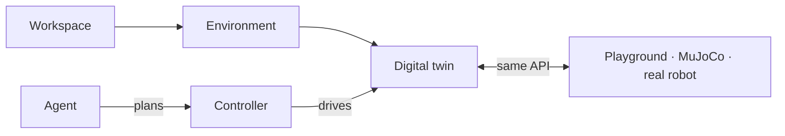

Five nouns cover everything in the quickstart. The rest of the docs builds on them.

| Concept | What it is | Example |
| --- | --- | --- |
| **Workspace** | Your team's container for environments, workflows, models and API keys. Billing and permissions live here. | *Personal*, *Acme R&D* |
| **Environment** | A 3D scene that holds twins, objects, cameras and areas. You edit it, simulate it, or run it live. | A workbench with an SO-101, a camera and two bins |
| **Digital twin** | A robot or sensor in an environment, created from a catalog asset. It has joints, controls and sensors, and mirrors the real device when one is paired. | `cw.twin("the-robot-studio/so101")` |
| **Controller** | Whatever drives a twin right now: a keyboard, your script, a workflow, or a trained policy. One controller at a time. | Keyboard teleop, a VLA policy |
| **Agent** | An AI assistant that builds environments, plans robot actions or drafts workflows from a plain-language request. You approve every plan. | Environment assistant, control agent, workflow assistant |

## Where commands run

The twin is the same object everywhere. You choose where its commands go:

| Mode | What runs | Cost | SDK |
| --- | --- | --- | --- |
| **Playground** | Kinematic simulation in your browser. No camera frames. | Free | `cw.affect("playground")` |
| **Simulation** | MuJoCo physics in the cloud, with rendered camera frames | [Credits](/billing/credits) | `cw.affect("simulation")` |
| **Live** | A physical robot paired through an edge computer | Your hardware | `cw.affect("live")` |

Build and test in simulation, then switch to live. The code doesn't change.

## Go deeper

<CardGroup cols={2}>
  <Card title="Architecture" icon="sitemap" href="/feature-reference/architecture/architecture">
    How the cloud, edge and hardware layers fit together.
  </Card>
  <Card title="Glossary" icon="book-open" href="/feature-reference/architecture/key-concepts">
    Every other term, A to Z.
  </Card>
</CardGroup>
