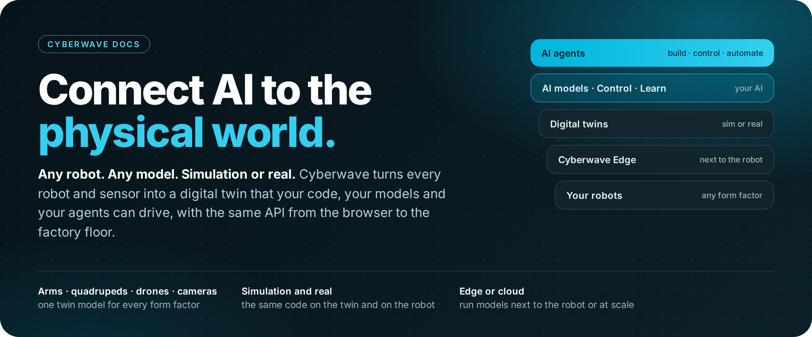
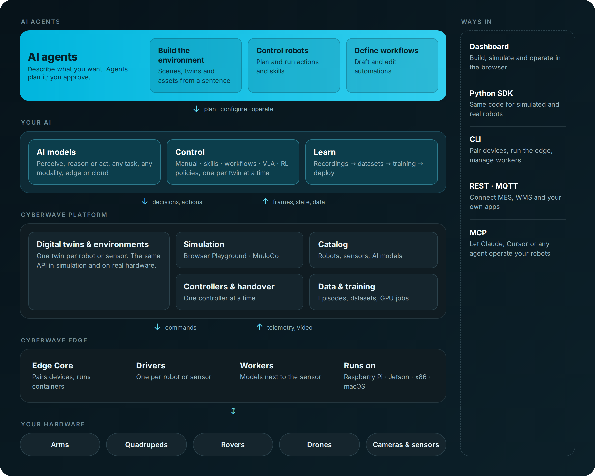

import AgentStartPrompt from "/snippets/agent-start-prompt.mdx";

Cyberwave connects AI to robots through digital twins. Prompt an agent to build a
scene and move a robot in simulation, then run the same twin on real hardware.
**No robot needed to start.**

## Start here

<AgentStartPrompt />

<Card className="welcome-card" title="Quickstart: AI agent to simulation" href="/get-started/quickstart">
  **Start with a free scene in your browser.** Build with Cyberwave's built-in
  agent, or connect Claude Code, Codex or Python. The MuJoCo motion and camera
  steps require credits.
</Card>

After the quickstart, [choose your path](/get-started/choose-your-path): write the
code yourself, try a real robot in our lab, or connect your own.

## Build with your tools

<CardGroup cols={3}>
  <Card className="welcome-card" title="Cyberwave skill" icon="terminal" iconType="light" href="/overview/tools/claude-skill">
    Install the Cyberwave skill to build with Claude Code, Codex and other compatible agents.
  </Card>
  <Card className="welcome-card" title="MCP server" icon="plug" iconType="light" href="/overview/tools/mcp-server">
    Connect your AI tools to Cyberwave and work with environments, twins and workflows.
  </Card>
  <Card className="welcome-card" title="Documentation on GitHub" icon="github" href="https://github.com/cyberwave-os/docs-mintlify">
    Browse the documentation source, report an issue or contribute an improvement.
  </Card>
</CardGroup>

## Find your way around

<CardGroup cols={3}>
  <Card className="welcome-card" title="Build with AI" icon="code" iconType="light" href="/ai/overview">
    Agents, AI models, workflows and how to connect your AI tool.
  </Card>
  <Card className="welcome-card" title="Simulate and test" icon="cube" iconType="light" href="/overview/hello-robot">
    Environments, twins, Playground and MuJoCo, teleoperation.
  </Card>
  <Card className="welcome-card" title="Connect hardware" icon="plug" iconType="light" href="/robots/overview">
    Supported robots, edge computers and adding your own.
  </Card>
  <Card className="welcome-card" title="Train and improve" icon="database" iconType="light" href="/overview/features/models-and-datasets">
    Record, build datasets, train VLA and RL policies, deploy.
  </Card>
  <Card className="welcome-card" title="Deploy and operate" icon="server" iconType="light" href="/feature-reference/workflows/workers/overview">
    Edge workers, cloud nodes, fleets and IT requirements.
  </Card>
  <Card className="welcome-card" title="Tutorials" icon="book-open" iconType="light" href="/tutorials">
    End-to-end projects, filtered by what you have.
  </Card>
</CardGroup>

## How Cyberwave fits together

**Digital twins** represent your robots and sensors. **Environments** bring them
into a scene. AI agents help build scenes and workflows; models and controllers
turn observations into actions. Cyberwave Edge connects twins to physical hardware.

New to the vocabulary? [Core concepts](/get-started/core-concepts) covers the five terms you need.

<Frame caption="AI agents plan; your models and controllers decide; digital twins run the same commands in simulation or on hardware through Cyberwave Edge.">
  
</Frame>

## Set up and get help

<CardGroup cols={2}>
  <Card className="welcome-card" title="Account and API keys" icon="key" iconType="light" href="/get-started/account">
    Create credentials when you are ready to connect an external agent or SDK.
  </Card>
  <Card className="welcome-card" title="Credits and billing" icon="credit-card" iconType="light" href="/billing/credits">
    Understand credits before starting cloud simulation or other metered features.
  </Card>
  <Card className="welcome-card" title="Discord" icon="discord" href="https://discord.gg/dfGhNrawyF">
    Ask the team and the community.
  </Card>
  <Card className="welcome-card" title="Troubleshooting" icon="life-ring" iconType="light" href="/support/troubleshooting">
    Find fixes for common setup and runtime issues.
  </Card>
</CardGroup>
